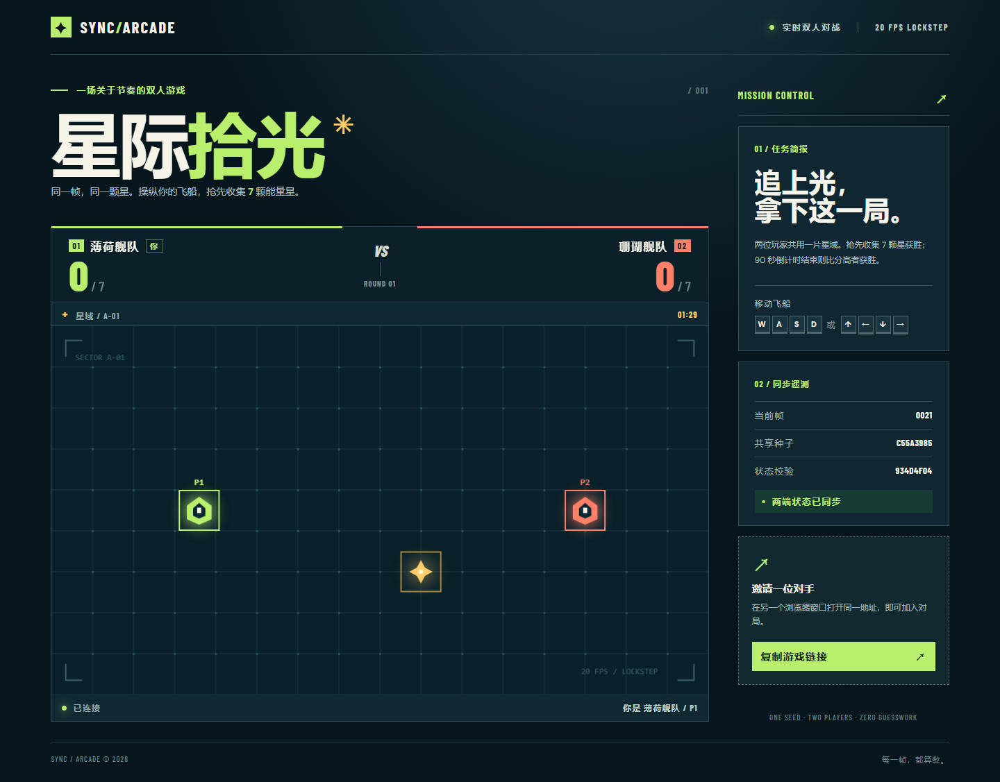
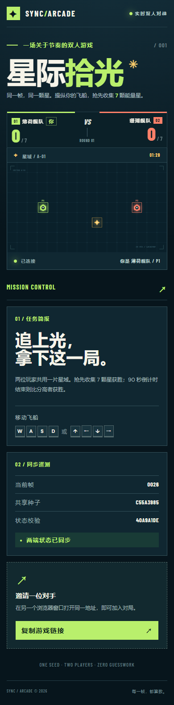

# 星际拾光 · 帧同步双人游戏

一款打开浏览器就能玩的双人拾星小游戏。两位玩家进入同一房间，各自控制一艘飞船；先收集 **7 颗星**获胜。若 90 秒结束时无人达到目标，则按分数决胜，同分为平局。

## 运行截图

桌面端：



移动端：



## 快速开始

需要 Node.js 20 或更新版本。在项目根目录执行：

```bash
npm ci
npm start
```

在两个浏览器窗口分别打开 **http://127.0.0.1:3000/**。第一位玩家进入后等待，第二位玩家加入即自动开局。使用 `WASD` 或方向键移动飞船。房间最多容纳两人；一方离线后会回到等待状态。每局结束 4 秒后自动开始下一局。

如需在局域网内用两台设备对战，可让服务端监听所有网卡：

```powershell
$env:HOST = '0.0.0.0'
npm start
```

然后在另一台设备访问运行服务端的电脑的局域网 IP，端口为 `3000`。如端口已被占用，可设置 `PORT` 环境变量后启动。

## 帧同步如何实现

1. 服务端为每局生成一个种子并发送给双方，每秒按固定节奏推进 **20 帧**。
2. 每帧服务端冻结双方最新的输入位掩码，用同一份规则计算状态，再广播帧号、输入和状态校验值。
3. 客户端只在收到完整帧后调用 `step()`；帧号或校验值不一致时立即停止推进并显示错误。

游戏规则遵循三条约束：

| 原则 | 实现 |
| --- | --- |
| 逻辑和画面分开 | `shared/game.js` 负责规则，`public/render.js` 只读取状态并绘制 Canvas。 |
| 计算只用整数 | 位置、移动、碰撞、计分、倒计时与校验值都按整数计算。 |
| 随机数共用一个种子 | 状态只保存一份 xorshift32 种子，星星生成依次从中取数。 |

`server.js` 负责双人房间、帧时钟与广播；`public/client.js` 负责按键、网络消息、状态校验和页面提示。服务端与浏览器直接使用同一个 `shared/game.js`，无需构建步骤。

## 测试

```bash
npm test
```

测试覆盖同种子回放、整数边界、拾取与终局，以及真实 WebSocket 连接中的双人开局、连续帧、满员和断线重置。

## 许可证

本项目采用 [MIT License](LICENSE)。
